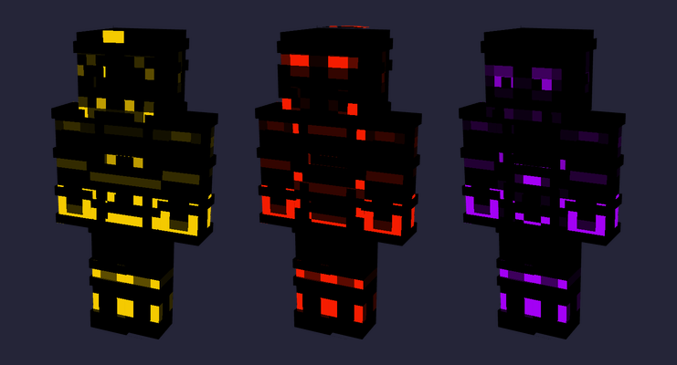
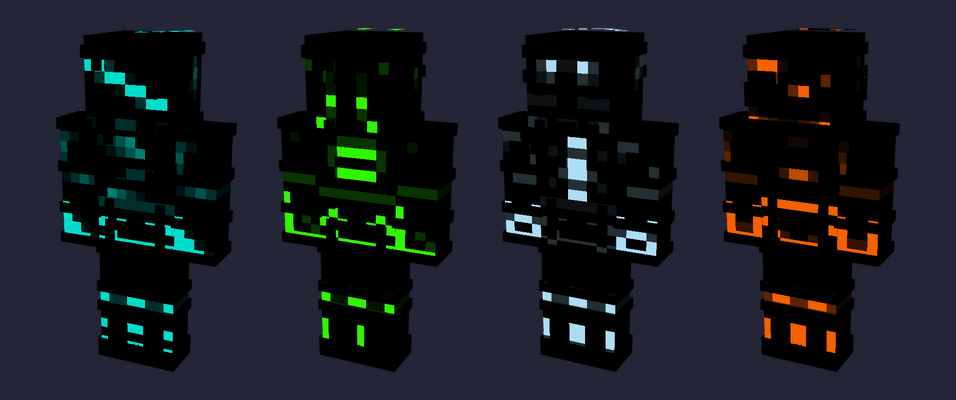
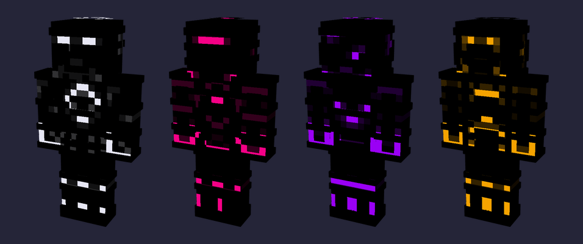

# Auffrisch-Kit: Glowing Samurai

## Schritte
1. Projekt **Edit** → **General**: Logo und Summary ersetzen
2. **Media**: altes Cover löschen, neues Cover mit Title **MCPEDL** hochladen, ★ Feature Media
3. **Description**: Text unten komplett ersetzen

## Felder
| Feld | Wert |
|---|---|
| Project name | **Glowing Samurai** (Ausweichnamen: Samurai Saga: Neon Blades of the Night · Shadow Ronin Glow) |
| Slug | glowing-samurai |
| Logo | [Glowing Samurai.png](https://raw.githubusercontent.com/Busja777/minecraft-mod-factory/main/data/skins/glowing-samurai/Glowing%20Samurai.png) |
| Summary | These are glowing samurai. Black armour, burning eyes, and something inside that refuses to stay sealed ... |
| Class | Skins |
| Main category | Players |
| Additional categories | Skin Packs |
| Allow Comments | ✓ |
| Unlisted project | ✗ |
| Enable Project Pages | ✗ |
| Project License | All Rights Reserved |
| Project distribution | Allow distribution to 3rd party |
| Source Code | The source code is not publicly available |
| Media → Bild | [Glowing Samurai Cover.png](https://raw.githubusercontent.com/Busja777/minecraft-mod-factory/main/data/skins/glowing-samurai/Glowing%20Samurai%20Cover.png) |
| Media → Title | **MCPEDL** (genau so, sonst übernimmt MCPEDL das Cover nicht) |
| Media → Description | Glowing Samurai Cover.png |
| Media → Feature Media | ★ aktivieren |

## Beschreibung (Markdown, komplett einfügen)

# Glowing Samurai

Long before the first torch was lit, the samurai of the three realms swore their souls to the dark. Their armour was forged black as a moonless night, and only their spirit was allowed to shine through the cracks: a thunder-gold crest on RAIJIN's helm, twin blood-red eyes burning behind ONI-KAI's mask, a faint violet haze where MUGEN's face should be. They say the light is not decoration. It is what remains of the warriors they once were, smouldering at the wrists, the knees and the eyes, refusing to go out. Some generals fell. Some were sealed away until their glow returned brighter than before. Others never belonged to any realm at all. When the night is darkest, watch for coloured bands moving between the trees... and pray they are not walking toward you.

*(The logo and cover inside the gallery are AI-generated.)*

## The Skins

The Three Realms Glow Pack: RAIJIN wakes in thunder-gold, ONI-KAI burns blood-red, and MUGEN drifts through the void in violet. The first three lights are on in the dark.

**RAIJIN — Thunder Samurai** · **ONI-KAI — Blood Oni** · **MUGEN — Void Ghost**

## Added in V1.1: KAZE-KI, DOKU-HA, HYOKETSU, KUROHONO

The Four Fallen Generals rise from defeat: KAZE-KI in cyan wind, DOKU-HA in toxic green, HYOKETSU in frozen ice-blue and KUROHONO in shadowed orange flame. They lost their war, but they kept their glow.

**KAZE-KI — Wind Wraith** · **DOKU-HA — Poison Blade** · **HYOKETSU — Frozen Warlord** · **KUROHONO — Shadow Flame**

## Added in V1.2: SHIROI-KI, JIGOKU-YA, RAIKAGE, TETSUKI

The Celestial Guardians come down from the heavens: SHIROI-KI with the white lotus on his chest, JIGOKU-YA with a hellfire-pink visor, RAIKAGE in storm violet and TETSUKI in forge amber. Their oath is older than the shogunate.

**SHIROI-KI — White Lotus** · **JIGOKU-YA — Hell Archer** · **RAIKAGE — Storm Shogun** · **TETSUKI — Iron Forge**

## How to install
1. Download the **.mcpack** file and open it. Minecraft imports the pack automatically.
2. In Minecraft open **Dressing Room → Classic Skins** and pick a skin from the pack.

Made for Minecraft Bedrock Edition.
